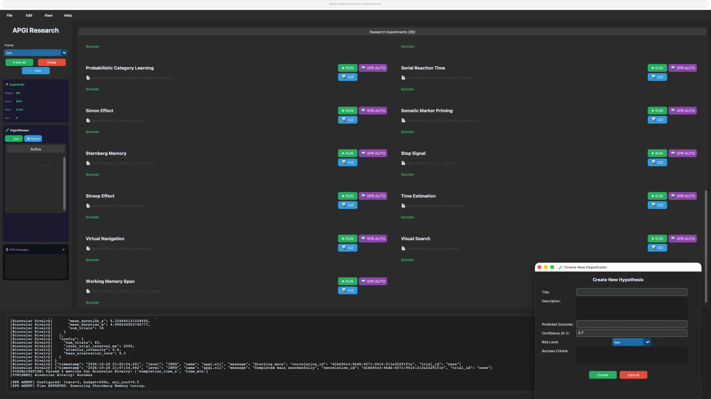

# APGI Research Platform

APGI Research is a Python desktop application and research toolkit for running psychological paradigm simulations, inspecting APGI dynamics, and improving experiment parameters with human oversight. It combines a CustomTkinter experiment dashboard, an autonomous optimization agent, hypothesis review, persistent memory, and security and observability modules.



The repository contains 29 experiment runners covering 28 paradigms, including a second Change Blindness implementation with full APGI integration. Internal implementation checks and simulated results do not establish clinical validity or regulatory certification.

## Application workflow

1. Launch `python GUI_auto_improve_experiments.py` from the repository root.
2. Select **RUN** on an experiment card, or **Run All** to execute the discovered runners sequentially. Follow status labels and the live console; use **Stop** to cancel running processes.
3. Select **VIZ** after a run to inspect its results and APGI metrics.
4. Select **XPR AUTO** to configure an optimization run and review the proposed plan before execution. Monitor confidence, regression, escalation counts, and parameter changes in the sidebar.
5. Create and review hypotheses, save result data, and export a research report from the menus.

## Contents

- [Desktop application features](#desktop-application-features)
- [Architecture](#architecture)
- [Protocol specification](#apgi-protocol-specification-110)
- [Supported experiments](#supported-experiments)
- [Usage](#usage)
- [Additional research tools](#additional-research-tools)
- [System configuration](#system-configuration)
- [Development](#development)
- [Troubleshooting](#troubleshooting)

## Desktop application features

### Experiment execution and management

The dashboard discovers `experiments/run_*.py` files at startup and can reload the list during a session. Each card shows the experiment name, script path, execution status, and RUN, XPR AUTO, and VIZ controls. Individual runs execute in background subprocesses and stream output to the console. **Run All** queues experiments sequentially.

The File and Edit menus support adding an experiment from a template or an existing Python script, opening the experiment directory, opening a script in an editor, deleting an experiment with confirmation, and clearing the current session. Available templates are **APGI Cognitive**, **Basic Experiment**, **Data Analysis**, and **Model Training**.

### Optimization and human review

XPR AUTO opens a pre-run configuration dialog for maximum iterations, time budget, minimum confidence, and protected-file patterns. Defaults are 3 iterations, 600 seconds, 0.5 minimum confidence, and `prepare_*.py` protection. A plan review step lets the researcher approve execution or modify the direction and request a new plan.

The agent runs experiments, compares metrics, proposes parameter changes, and records outcomes through Git, checkpoints, and memory. The XPR Changes panel displays parameter modifications. The guardrail dashboard displays status, confidence, latest regression, and escalation count, with notifications when intervention is needed. Optimization can change runner files and create Git history; use a clean working tree before starting.

### Hypothesis board

Create a hypothesis with a title, description, predicted outcome, confidence score, risk level, and success criteria. The sidebar lists active hypotheses, while the review dialog provides approval and rejection controls. The underlying approval-board module stores hypotheses and review information for use by the human control layer.

### Results and visualization

Results parsed from experiment output feed embedded Matplotlib charts and separate visualization windows. Task-specific views are supplemented by reusable panels for core dynamics, measurement proxies, neuromodulators, domain metrics, hierarchical processing, state-space trajectories, and the precision–expectation gap. See [visualization helpers](visualization_helpers/README.md) for the plotting API.

Save current results as JSON and export a Markdown research report containing experiment availability, run status, guardrail metrics, and pending hypotheses. The console can be cleared, copied to the clipboard, or saved as a log. Visualization windows can be opened together, reset, or closed from the View menu.

### Monitoring, appearance, and support

- View task progress and completion status in the progress dialog; the progress module also supports summaries and checkpoint persistence.
- Search and refresh the JSONL audit trail in the audit-log viewer.
- Switch appearance modes, show or hide the sidebar, expand the console, adjust zoom, and refresh the interface.
- Check dependency status and invoke dependency repair from the application.
- Open built-in getting-started instructions, experiment tutorials, XPR guidance, API documentation, templates, system information, and issue/feedback dialogs.

### Current interface limitations

The result-import dialog currently acknowledges a selected file without loading its data. Result saving writes JSON even if a CSV extension is selected; report export writes Markdown even if HTML or PDF is selected. Use `.json` and `.md` respectively. The Settings dialog saves values to `.apgi_settings.json`, but does not currently load or apply them to the runtime; its concurrency, autosave, and refresh controls should not be treated as active features. The additional-constraints text box in XPR configuration is displayed but is not copied into the submitted run configuration.

## Quick Install

Requires Python 3.10-3.13. On macOS with Homebrew, first run
`brew install python@3.13 python-tk@3.13` (`python-tk` provides `tkinter` for the GUI).

```bash
python3.13 -m venv .venv
source .venv/bin/activate
pip install -e ".[dev]"
python GUI_auto_improve_experiments.py
```

See [Installation](#installation) for notes on Homebrew's externally-managed
Python and on stale editable installs.

## Architecture

The APGI Research Application implements a comprehensive autonomous learning algorithm with multiple integrated layers:

### Core System Components

#### 1. Human Control Layer (`human_layer.py`)

- `HumanControlLayer` - Interactive configuration and approval workflow
- Task prioritization with `TaskPriority` enum (CRITICAL, HIGH, MEDIUM, LOW)
- Review & Decision system with `ReviewDecision` enum (APPROVE, MODIFY, REJECT)
- Three interaction modes: interactive, batch, autonomous
- Integration with `hypothesis_approval_board.py` for hypothesis management

#### 2. Agent Harness (`autonomous_agent.py`)

- `AutonomousAgent` - Main controller orchestrating optimization loops
- `GitPerformanceTracker` - Version control-based performance tracking with async operations
- `ParameterOptimizer` - AI-driven parameter modification with experiment-specific strategies
- `AsyncGitOperations` - Non-blocking git commits for continuous optimization
- Checkpoint system for crash recovery

#### 3. Agent Execution Engine (`xpr_agent_engine.py`)

- `XPRAgentEngine` - Core engine with skill registration and execution
- `XPRAgentEngineEnhanced` - Advanced engine with LLM integration via litellm
- `LLMIntegration` - Multi-provider LLM support (OpenAI, Anthropic, local models)
- Self-healing skill chain: `xpr_job_debug` → `xpr_issue_fix` → `xpr_issue_report`
- LLM-generated code patches with syntax validation

#### 4. Memory System (`memory_store.py`)

- `MemoryStore` - Indexed knowledge base with TF-IDF semantic search
- `MemoryEntry` - Structured storage for patterns, strategies, and failures
- `VectorEmbedding` - Neural-style embeddings for semantic similarity
- Hybrid search combining TF-IDF and vector similarity
- `update_memory_from_report()` - Automatic extraction of lessons learned

#### 5. Experiment GUI (`GUI_auto_improve_experiments.py`)

- `ExperimentRunnerGUI` - Modern CustomTkinter interface
- Real-time experiment execution and visualization
- Hypothesis approval board integration
- Results visualization with matplotlib
- Guardrail dashboard with live metrics
- 1400×900 pixel default window, responsive layout

#### 6. APGI Core (`APGI_System.py`)

- Complete dynamical system implementation
- 51 psychological states with Π vs Π̂ distinction
- Neuromodulator mapping (ACh, NE, DA, 5-HT)
- Measurement equations (HEP, P3b, detection thresholds)
- Hierarchical 5-level processing
- Psychiatric profile modeling (GAD, MDD, Psychosis)

### Production Infrastructure Modules

#### 7. Config Management (`apgi_config.py`)

- `APGIExperimentConfigSchema` - Pydantic schema for experiment config
- `APGISecurityConfigSchema` - Security configuration validation
- `APGIMetricsConfigSchema` - Metrics and monitoring config
- `ConfigManager` - Singleton configuration manager with:
  - Environment variable loading (APGI_* prefix)
  - JSON/YAML config file support
  - LRU caching for performance
  - Source tracking for debugging

#### 8. CLI Framework (`apgi_cli.py`)

- Standardized CLI entry point with `cli_entrypoint()`
- `@require_auth` decorator for authorization enforcement
- `create_standard_parser()` for consistent argument handling
- Exit codes: 0 (success), 77 (auth denied), 78 (config error), 130 (interrupted)
- Legacy compatibility via `standardized_main()`

#### 9. Security Adapters (`apgi_security_adapters.py`)

- `SecurityContext` - Per-context security configuration
- `SecurityLevel` enum: PERMISSIVE, STANDARD, STRICT
- Deny-by-default subprocess allowlist
- Explicit pickle/serialization controls (JSON, msgpack, protobuf)
- Security metrics and telemetry
- KMS-backed secret support

#### 10. Orchestration Kernel (`apgi_orchestration_kernel.py`)

- `APGIOrchestrationKernel` - Central runner framework
- `TrialTransformer` - Abstract base for experiment-specific transformations
- `ExperimentRunConfig` - Typed configuration for runs
- `TrialMetrics` - Standardized metrics across all experiments
- Unified trial processing pipeline

#### 11. Authorization (`apgi_authz.py`)

- Role-based access control (RBAC)
- `Role` enum: ADMIN, OPERATOR, RESEARCHER, REVIEWER, AUDITOR
- `Permission` enum for granular access control
- `AuthorizationContext` for permission checks
- `OperatorIdentity` for user tracking
- Consent tracking for GDPR compliance

#### 12. Audit System (`apgi_audit.py`)

- `AuditSink` - Immutable audit logging with HMAC signatures
- `AuditEventType` enum covering all system events
- Chain verification for integrity
- Export to JSON for compliance reviews
- Event filtering and querying
- Tamper-evident hash chain

#### 13. Data Retention (`apgi_data_retention.py`)

- `RetentionScheduler` - Automated data lifecycle management
- `RetentionPolicy` enum: GDPR_DEFAULT, HIPAA_MINIMUM, RESEARCH_EXTENDED
- Right to erasure (GDPR Article 17) implementation
- Right to data portability export
- Real deletion executors (not simulated)
- Deletion verification with audit trail

#### 14. Timeout Abstraction (`apgi_timeout_abstraction.py`)

- Cross-platform timeout management (Windows, macOS, Linux)
- `TimeoutManager` with context manager and decorator support
- `CancellableOperation` for cooperative cancellation
- `SignalTimeout` for Unix signal-based timeouts
- `ThreadTimeout` for cross-platform thread-based timeouts

#### 15. Profiling (`apgi_profiler.py`)

- `APGILoggingProfiler` - Structured logging profiler
- `@profiled` decorator for automatic profiling
- Function, method, and line-level profiling
- `ProfilingLevel` enum: NONE, FUNCTION, METHOD, LINE
- Metrics export to JSON/CSV

#### 16. Error Handling (`apgi_errors.py`)

- Comprehensive error taxonomy with `APGIBaseError`
- `APGIValidationError` - Parameter validation failures
- `APGITimeoutError` - Timeout violations
- `APGIAuthorizationError` - Permission denied
- `APGIAuditError` - Audit system failures
- `APGIComplianceError` - Compliance violations
- `APGIIntegrationError` - Integration failures
- Exception chaining with `__cause__`

#### 17. Structured Logging (`apgi_logging.py`)

- `APGIContextLogger` - Contextual logging with operator tracking
- `APGIFormatter` - JSON/formatted output
- Context variables: operator_id, experiment_id, trial_id
- Log level: DEBUG, INFO, WARNING, ERROR, CRITICAL
- Integration with audit sink

#### 18. Metrics (`apgi_metrics.py`)

- `MetricsCollector` - Centralized metrics collection
- Prometheus-compatible export format
- Custom metric types: Counter, Gauge, Histogram
- Metric tagging with labels
- Time-series data export

#### 19. Integration (`apgi_integration.py`)

- `APGIIntegration` - Main integration class for experiments
- `APGIParameters` - Parameter validation and storage
- `PrecisionExpectationState` - Π vs Π̂ distinction
- `HierarchicalProcessor` - 5-level hierarchical processing
- Neuromodulator mappings to precision parameters

#### 20. Validation (`apgi_validation.py`)

- `APGIParameterValidator` - Parameter range validation
- `ExperimentValidator` - Experiment structure validation
- Input sanitization for security
- Schema validation with Pydantic

#### 21. Double Dissociation (`apgi_double_dissociation.py`)

- Two-stage estimation protocol
- Stage 1: Anchor Πⁱ_baseline (min 3 sessions, ICC ≥ 0.65)
- Stage 2: Fit β parameter
- Physiological anchoring with EEG alpha/gamma power
- Stability fallback to composite Π_eff

#### 22. Compliance (`apgi_compliance.py`)

- `ComplianceManager` - Central compliance checking
- GDPR, CCPA, HIPAA control mapping
- Data classification (PUBLIC, INTERNAL, CONFIDENTIAL, RESTRICTED)
- Policy enforcement validation
- Compliance report generation

### Key Features

- **Human-in-the-Loop Control**: Interactive approval workflow with APPROVE/MODIFY/REJECT decisions
- **Self-Healing Experiments**: Automatic error detection, debugging, and retry with skill chaining
- **Skill Chaining System**: Modular agent skills (debug → fix → report) for autonomous recovery
- **Cognitive Memory**: TF-IDF and vector embeddings for pattern recognition across iterations
- **Infinite Autonomous Optimization**: Continuous parameter optimization with async git operations
- **Comprehensive Guardrails**: Confidence thresholds, metric regression detection, safety violations
- **Git-Based Learning**: Version control tracking with automatic rollback on failures
- **Multi-Experiment Support**: 29 dynamically discovered runners covering 28 psychological paradigms
- **LLM Integration**: Multi-provider support (OpenAI, Anthropic, local) via litellm
- **Real-Time Monitoring**: GUI with live experiment execution and embedded matplotlib visualization
- **Crash Recovery**: Checkpoint system for resuming after interruptions

### Security & Compliance Features

- **Deny-by-Default Security**: Subprocess allowlist, pickle/serialization controls
- **Role-Based Access Control**: 5 roles (ADMIN, OPERATOR, RESEARCHER, REVIEWER, AUDITOR)
- **Immutable Audit Logging**: HMAC-signed audit trail with chain verification
- **GDPR/CCPA/HIPAA Compliance**: Data retention, right to erasure, data portability
- **Cross-Platform Timeouts**: Windows, macOS, Linux timeout abstraction
- **Structured Logging**: JSON logging with operator/experiment context
- **Security Metrics**: Real-time security telemetry and deny metrics

## APGI Protocol Specification 1.1.0

The experimental protocols in [`protocols/`](protocols/) follow APGI protocol specification
1.1.0, byte-identical to [apgi-framework](https://github.com/apgiframework/apgi-framework)
1.1.0. Validate them with `make protocols-check`; see [`protocols/CHANGELOG.md`](protocols/CHANGELOG.md)
for what changed from 1.0. Under 1.1.0 a failure to confirm a prediction is not falsification
(verdicts are CONFIRMED, FALSIFIED or INDETERMINATE), and κ (ATP/bit) is uncalibrated.

`utils/apgi_protocol_spec.py` loads the registered protocols and provides
`classify_prediction()` for the three-way verdict. `check_parameter_defaults()` compares the
`APGI_System.APGIParameters` defaults with the registered θ₀, γ_sig and β_SM ranges. The
default somatic gain `beta = 1.5` lies outside the registered β_SM range [0.3, 0.7], so it
must not be used for a confirmatory fit.

The 29 experiments below are paradigm simulations for autonomous parameter tuning. They are
not the registered Protocol 0–7 studies, and their "APGI compliance" score is this platform's
internal implementation check, not a protocol verdict.

## Supported Experiments

The dashboard discovers 29 runners for the following 28 paradigms. Change Blindness has both standard and full-APGI runners. Metric names below describe task outcomes; consult each runner for its emitted result schema.

| Category | Experiment | Primary Metric |
| -------- | ---------- | ------------- |
| **Decision-Making** | Iowa Gambling Task | `net_score` |
| | Go/No-Go | `d_prime` |
| | Stop Signal | `ssrt_ms` |
| | Simon Effect | `simon_effect_ms` |
| **Attention** | Attentional Blink | `blink_magnitude` |
| | Posner Cueing | `cueing_effect_ms` |
| | Visual Search | `conjunction_slope` |
| | Change Blindness | `change_detection_rate` |
| | Inattentional Blindness | `detection_rate` |
| | Navon Task | `global_local_bias` |
| **Memory** | Dual N-Back | `d_prime` |
| | Sternberg Memory | `memory_scan_rate` |
| | Working Memory Span | `span_size` |
| | DRM False Memory | `false_alarm_rate` |
| | Serial Reaction Time | `sequence_learning` |
| | Artificial Grammar Learning | `grammar_accuracy` |
| **Interference** | Stroop Effect | `interference_effect_ms` |
| | Eriksen Flanker | `flanker_effect_ms` |
| | Masking | `backward_masking_effect` |
| **Perception** | Binocular Rivalry | `dominance_duration` |
| | Multisensory Integration | `integration_index` |
| | Time Estimation | `temporal_precision` |
| **Specialized** | Somatic Marker Priming | `priming_effect` |
| | Interoceptive Gating | `gating_ratio` |
| | Metabolic Cost | `metabolic_efficiency` |
| | Virtual Navigation | `navigation_accuracy` |
| | Probabilistic Category Learning | `category_accuracy` |
| | AI Benchmarking | `benchmark_score` |

## Usage

### Environment Setup

```bash
# Set required environment variables
export APGI_OPERATOR_ID="user123"
export APGI_OPERATOR_NAME="Researcher Name"
export APGI_OPERATOR_ROLE="operator"  # admin, operator, researcher, reviewer, auditor

# Optional security settings
export APGI_ENABLE_PROFILING=false
export APGI_KMS_KEY="your-kms-key"
export APGI_AUDIT_KEY="your-audit-key"

# Load from config file
export APGI_CONFIG_FILE="config/apgi.json"
```

### Command Line Interface

#### Standard CLI Entry Point (Recommended)

```bash
# Run experiment with standardized CLI
python -m experiments.run_iowa_gambling_task --trials 100 --verbose
python -m experiments.run_stroop_effect --operator user123 --role operator

# Run autonomous optimization
python autonomous_agent.py --experiment masking --iterations 100
python autonomous_agent.py --all-experiments --iterations 50
python autonomous_agent.py --overnight
```

#### Legacy Entry Points

```bash
# Direct experiment execution (for backward compatibility)
python -m experiments.run_attentional_blink
python -m experiments.run_visual_search
python -m experiments.run_change_blindness

# Data preparation
python prepare.py

# Training script
python train.py
```

### GUI Interface

```bash
# Launch the graphical interface
python GUI_auto_improve_experiments.py

# The GUI starts directly; configure it through its menus.
```

The GUI provides:

- Real-time experiment execution with CustomTkinter interface
- Guardrail dashboard with live metrics (confidence, regression, escalation count)
- Hypothesis approval board integration
- Individual background runs and a sequential Run All queue
- Results visualization with embedded matplotlib
- 1400×900 pixel default window, responsive layout

### API Integration

#### Core Components

```python
from autonomous_agent import AutonomousAgent
from human_layer import HumanControlLayer
from memory_store import MemoryStore
from xpr_agent_engine import XPRAgentEngineEnhanced

# Initialize components
agent = AutonomousAgent()
human = HumanControlLayer()
memory = MemoryStore()
engine = XPRAgentEngineEnhanced()

# Configure human interaction layer
human.configure_if_needed()

# Run optimization with human oversight
results = agent.optimize_experiment("attentional_blink", iterations=100)

# Run single experiment with modifications
result = agent.run_experiment(
    "masking",
    modifications={"BASE_DETECTION_RATE": 0.5},
    timeout_seconds=1800,
    max_retries=1
)

# Record a successful outcome for later searches
if result.status == "success":
    memory.add_memory_with_embedding(
        experiment_name="masking",
        pattern_type="success_pattern",
        content="Completed masking run with BASE_DETECTION_RATE=0.5",
        context={"primary_metric": str(result.primary_metric)}
    )
```

#### Security & Authorization

```python
from apgi_security_adapters import get_security_factory, SecurityLevel
from apgi_authz import get_authz_manager, Role, Permission, AuthorizationContext
from apgi_audit import get_audit_sink, AuditEventType
from apgi_config import get_config

# Security context
factory = get_security_factory()
context = factory.create_context(
    operator_id="user123",
    security_level=SecurityLevel.STANDARD,
)
secure_popen = factory.get_secure_popen(context)

# Authorization
authz = get_authz_manager()
operator = authz.register_operator("john", Role.OPERATOR)
auth_context = AuthorizationContext(
    operator=operator,
    resource_type="experiment",
    resource_id="iowa_gambling",
    action=Permission.RUN_EXPERIMENT,
)
if authz.authorize_action(auth_context):
    print("Permission granted")

# Audit logging
audit = get_audit_sink()
audit.record_event(
    event_type=AuditEventType.EXPERIMENT_STARTED,
    operator_id="user123",
    operator_name="John Doe",
    resource_type="experiment",
    resource_id="iowa_gambling",
    action="start",
)

# Configuration
config = get_config()
experiment_config = config.get_experiment_config("stroop_effect")
security_config = config.get_security_config()
```

#### Orchestration Kernel

```python
from apgi_orchestration_kernel import (
    get_orchestration_kernel,
    ExperimentRunConfig,
    TrialTransformer,
)
from apgi_config import get_config

class MyTrialTransformer(TrialTransformer):
    def transform_trial(self, trial_data):
        return trial_data
    
    def extract_prediction_error(self, trial_data):
        return trial_data["error"]
    
    def extract_precision(self, trial_data):
        return trial_data["precision"]

# Run experiment through kernel
kernel = get_orchestration_kernel()
config = get_config()
apgi_config = config.get_experiment_config("iowa_gambling")

run_config = ExperimentRunConfig(
    experiment_name="iowa_gambling",
    operator_id="user123",
    operator_name="John Doe",
    apgi_config=apgi_config,
)

run_context = kernel.create_run_context(run_config)
for trial_data in trials:
    metrics = kernel.process_trial(run_context, trial_data, MyTrialTransformer())
results = kernel.finalize_run(run_context)
```

## Additional research tools

| Tool | Existing functionality |
| ---- | ---------------------- |
| `progress_tracking.py` | Task states, elapsed time, progress summaries, JSON export, checkpoint save/load, and restoration of task state. |
| `validation.py` and `utils/apgi_validation.py` | Experiment and parameter validation; see the protocol section for registered-study checks. |
| `analyze_experiments.py` | Analysis and report generation from a bundled results dictionary; this is a snapshot analysis, not an automatic reader of the latest GUI session. |
| `prepare.py` | Download training-data shards, train a BPE tokenizer, and cache preparation artifacts in `~/.cache/autoresearch/`. Use `python prepare.py --num-shards 8` for a smaller preparation run. |
| `train.py` | Single-device language-model pretraining and evaluation using the prepared data, with CUDA, Apple MPS, or CPU selection. This is separate from the psychological experiment simulations. |
| `paper-miner.py` | Standalone literature-search GUI for PubMed, arXiv, bioRxiv, and OpenAlex; method/entity/effect-size extraction, editable search configuration, and CSV/JSON export. Requires the additional `arxiv` and `biopython` packages and a configured contact email for PubMed. Launch with `python paper-miner.py`. |

For full workflows, see the [usage guide](docs/APGI-USAGE-GUIDE.md),
[algorithm description](docs/ALGORITHM.md), [operational playbooks](docs/Operational-Playbooks.md),
and [maturity matrix](docs/Maturity-Matrix.md).

## System Configuration

### Environment Variables

| Variable | Description | Required | Default |
| -------- | ----------- | -------- | ------- |
| `APGI_OPERATOR_ID` | Unique operator identifier | No | auto-generated |
| `APGI_OPERATOR_NAME` | Human-readable operator name | No | "cli_user" |
| `APGI_OPERATOR_ROLE` | Role (admin, operator, researcher, reviewer, auditor) | No | "operator" |
| `APGI_CONFIG_FILE` | Path to config file | No | auto-search |
| `APGI_ENABLE_PROFILING` | Enable performance profiling | No | false |
| `APGI_PROFILING_LEVEL` | Profiling detail level | No | "function" |
| `APGI_AUDIT_KEY` | HMAC signing key for audit trail | **Yes** | none |
| `APGI_KMS_KEY` | KMS key for config checksum validation | **Yes** | none |
| `APGI_CONFIG_SECRET_KEY` | Config validation secret | **Yes** | none |
| `APGI_PSEUDONYM_SALT` | Pseudonymization salt | **Yes** | none |

### Installation

1. **Core Requirements** (Python 3.10+)

   ```bash
   # Using uv (recommended)
   uv sync
   
   # Using pip (always inside a virtual environment, see below)
   pip install -e .
   ```

   **macOS / Homebrew Python.** Homebrew marks its Python as externally managed
   (PEP 668), so a bare `pip install` is refused. Do not use
   `--break-system-packages`; create a virtual environment instead:

   ```bash
   brew install python@3.13 python-tk@3.13   # python-tk provides tkinter for the GUI
   python3.13 -m venv .venv
   source .venv/bin/activate
   pip install -e ".[dev]"
   ```

   Use Python 3.10-3.13: `torch` and other binary dependencies usually publish
   wheels only for released Python versions, so a pre-release interpreter
   (for example 3.15) will fail to resolve them. If `pip` or `python` prints
   errors about `__editable__.*.pth` files from other projects, those are stale
   installs in the system site-packages; the virtual environment above avoids
   them (remove them with `pip uninstall apgi apgi-framework` outside the venv).

2. **Development Dependencies**

   ```bash
   pip install -r requirements-test.txt
   ```

### Config File Format

```json
{
  "experiment_iowa_gambling_tau_s": 0.35,
  "experiment_iowa_gambling_beta": 1.5,
  "security_audit_enabled": true,
  "security_authz_enabled": true,
  "metrics_profiling_enabled": false
}
```

### Performance Tuning

- **GPU Acceleration**: Automatic CUDA detection and utilization
- **Memory Optimization**: Ring-buffered deques for bounded history
- **Parallel Processing**: Multi-threaded experiment execution
- **Timeout Management**: Cross-platform configurable timeouts
- **Caching**: LRU cache for config access, TTL for static assets

## Development

### Testing

The test suite covers experiment runners, agent behavior, infrastructure, and GUI helpers:

```bash
# Run all tests
pytest

# Run with coverage
pytest --cov=. --cov-report=html

# Run specific component tests
pytest tests/test_autonomous_agent.py
pytest tests/test_xpr_agent_engine_comprehensive.py
pytest tests/test_human_layer.py
pytest tests/test_memory_store.py
pytest tests/test_rl_loop.py

# Run integration tests
pytest tests/test_integration_experiments.py

# Run performance and stress tests
pytest tests/test_performance_stress.py

# Run security tests
pytest tests/test_security.py

# GUI tests with Playwright
pytest tests/test_gui_playwright.py
```

### Test Coverage Areas

- **Unit Tests**: Core components (autonomous_agent, xpr_agent_engine, human_layer, memory_store)
- **Integration Tests**: Full RL loop, experiment execution, end-to-end workflows
- **XPR Engine Tests**: Skill chaining, LLM integration, self-healing mechanisms
- **Human Layer Tests**: Review workflow, approval decisions, configuration
- **Memory Tests**: Semantic search, vector embeddings, pattern extraction
- **Performance Tests**: Stress testing, timeout handling, async operations
- **Security Tests**: Input validation, module loading, sandboxed execution
- **GUI Tests**: Playwright-based UI automation and visualization

### Code Quality

```bash
# Linting
flake8 autonomous_agent.py GUI_auto_improve_experiments.py

# Formatting
black *.py

# Type checking
mypy autonomous_agent.py
```

### Documentation

```bash
# Generate coverage report
pytest --cov=. --cov-report=html
```

## Troubleshooting

### Common Issues

1. **Module Import Errors**

   - Clear Python cache: `python -B -m pytest`
   - Check PYTHONPATH configuration
   - Verify experiment file structure

2. **Git Repository Issues**

   - Initialize git repo: `git init`
   - Check permissions on .git directory
   - Verify remote repository configuration

3. **Performance Issues**

   - Monitor memory usage with `htop`
   - Check GPU availability: `nvidia-smi`
   - Optimize experiment parameters

4. **GUI Issues**

   - Check CustomTkinter installation
   - Verify display server configuration
   - Test with minimal example

### Debug Mode

```bash
# Enable debug logging
python autonomous_agent.py --experiment masking --iterations 1

# Open the GUI and inspect its live console
python GUI_auto_improve_experiments.py
```

## Contributing

### Development Workflow

1. Fork the repository
2. Create feature branch
3. Add tests for new functionality
4. Ensure code quality standards
5. Submit pull request

### Code Standards

- **PEP 8** compliance
- **Type hints** for all public APIs
- **Docstrings** for all classes and methods
- **Tests** with >70% coverage
- **Security** review for all changes

## Citation

If you use this platform in your research, please cite:

```bibtex
@software{pesochin_apgi_research_2026,
  title={APGI Research: Allostatic Precision-Gated Ignition — Autonomous Research Platform},
  author={Pesochin, Dimitry},
  year={2026},
  version={1.1.0},
  doi={10.5281/zenodo.21632264},
  url={https://github.com/apgiframework/apgi-research},
  orcid={https://orcid.org/0009-0005-0328-2896}
}
```

## License

This project is licensed under the MIT License. See LICENSE file for details.

## Acknowledgments

### Core Frameworks

- **ALGORITHM** - Autonomous learning algorithm with human-in-the-loop
- **APGI** - Allostatic Precision-Gated Ignition framework
- **CustomTkinter** - Modern GUI framework (5.0+)
- **Pydantic** - Data validation and settings management
- **litellm** - Multi-provider LLM API integration

### Infrastructure & Security

- **GitPython** - Git integration for version control learning
- **sentence-transformers** - Semantic embeddings for memory system
- **PyTorch** - Deep learning backend
- **NumPy** - Numerical computing foundation
- **Matplotlib** - Visualization and plotting

### Production Infrastructure

- **apgi_config** - Typed configuration management
- **apgi_cli** - Standardized CLI framework
- **apgi_security_adapters** - Injectable security controls
- **apgi_orchestration_kernel** - Central experiment runner
- **apgi_authz** - Role-based access control
- **apgi_audit** - Immutable audit logging
- **apgi_data_retention** - Data lifecycle management
- **apgi_timeout_abstraction** - Cross-platform timeouts

### Testing & Quality

- **pytest** - Testing framework
- **Playwright** - Browser automation for GUI testing
- **flake8** - Code linting
- **mypy** - Static type checking
- **black** - Code formatting
- **mutation_testing** - Test effectiveness verification

## Quick Start

```bash
# Install dependencies (inside a virtual environment, see Quick Install above)
pip install -e .

# Set required environment variables
export APGI_AUDIT_KEY="$(openssl rand -hex 32)"
export APGI_KMS_KEY="$(openssl rand -hex 32)"
export APGI_CONFIG_SECRET_KEY="$(openssl rand -hex 32)"
export APGI_PSEUDONYM_SALT="$(openssl rand -hex 16)"

# Run experiments
python GUI_auto_improve_experiments.py

# Or use CLI
python -m experiments.run_stroop_effect --help
```

## Requirements

- Python 3.10+
- See `requirements-test.txt` for development dependencies
- See `pyproject.toml` for runtime dependencies

## Support

For issues, questions, or contributions:

- **GitHub Issues**: Report bugs and feature requests
- **Documentation**: Check README.md and inline docs
- **Community**: Join discussions in GitHub Discussions

- `docs/APGI-USAGE-GUIDE.md` - Complete usage guide
- `docs/ALGORITHM.md` - Algorithm documentation
- `docs/APGI-COMPLIANCE.md` - Compliance framework
- `TODO.md` - Current tasks and known issues

## Version

See `pyproject.toml` for current version (accessed via `apgi_version.get_version()`)
